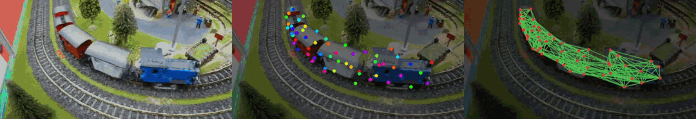

# XM4D: 4D Reconstruction through Certifiable Geometric Optimization

**Haoyu Han, Jack Benarroch Jedlicki, Jiahui Lei, Heng Yang**

[Project page](https://computationalrobotics.seas.harvard.edu/XM4D/) · [arXiv](https://arxiv.org/abs/2611.07902)

XM4D splits 4D reconstruction into a static and a dynamic stage, and solves each one with a certifiably globally optimal
GPU solver before any photometric training.

<p align="center">
  
  <br>
  <em>DAVIS train. Left to right: 4D Gaussian render, 3D tracks, embedded deformation graph.</em>
</p>

> **Reproducing the paper's results:** please see the
> [`reproduce` branch](https://github.com/ComputationalRobotics/XM4D-release/tree/reproduce), which ships the
> preprocessed benchmark inputs, the pinned configs and the runners. This `main` branch is the method code, for running
> XM4D on your own videos.

## Install

Requirements: Linux x86-64, an NVIDIA GPU with a driver for CUDA 12, and conda.

```bash
git clone https://github.com/ComputationalRobotics/XM4D-release.git
cd XM4D-release

# third-party code goes in deps/ (not tracked)
git clone https://github.com/google-deepmind/tapnet.git deps/tapnet
mkdir -p deps/tapnet/checkpoints
wget -P deps/tapnet/checkpoints https://storage.googleapis.com/dm-tapnet/tapnextpp/tapnextpp_ckpt.pt
git clone https://github.com/ByteDance-Seed/Depth-Anything-3.git deps/Depth-Anything-3
git clone https://github.com/MIT-SPARK/TEASER-plusplus.git deps/TEASER-plusplus
git clone https://github.com/facebookresearch/sam3.git ~/sam3
```

Each stage runs in its own conda environment. The runner scripts in `Python/bashes/` activate them by these names:

| env | stage | what it needs |
|---|---|---|
| `sam3` | 0. masks | [SAM 3](https://github.com/facebookresearch/sam3) installed per its README, plus `jupyter ipympl`. The `facebook/sam3` weights on Hugging Face are gated: request access, then `hf auth login` |
| `da3` | 1. depth | [Depth Anything 3](https://github.com/ByteDance-Seed/Depth-Anything-3) installed per its README (`pip install -e deps/Depth-Anything-3`), plus `opencv-python open3d scipy` |
| `tapnet` | 2. tracking | `torch torchvision einops opencv-python scipy tqdm`. The scripts import TAPNext from `deps/tapnet` directly |
| `XM` | 3–5. solver, deformation graph, 4DGS data | see below |

The `XM` environment runs the XM solver. Its compiled binding `XM/build/XM.cpython-310-x86_64-linux-gnu.so` (Python
3.10, CUDA 12.4) ships with this repo:

```bash
conda create -n XM python=3.10 eigen=3.4.0 cmake -c conda-forge -y
conda activate XM
pip install numpy scipy opencv-python open3d networkx pyceres pycolmap pandas matplotlib tqdm viser
pip install ./deps/TEASER-plusplus

export CUDA_HOME=/usr/local/cuda-12.4      # your CUDA 12.x toolkit
export LD_LIBRARY_PATH=$CONDA_PREFIX/lib:$CUDA_HOME/lib64:$LD_LIBRARY_PATH
```

The exact package versions behind the paper's numbers are pinned in the `reproduce` branch's `requirements.txt`.

## Usage

Put the frames of a video in a scene folder:

```
datasets/<Category>/<scene>/images/     frames, sorted by the number in the file name
```

Use `Custom` (`.jpg` frames) for your own videos. The other categories (`DAVIS`, `Dycheck`, `NVIDIA`, `Sintel`,
`Syn4D`, `TUM`, `Replica`, `IMC`, `Lab`) set the frame pattern in `Python/utils/definitions.py` and the parameters in
`Python/configs/<category>.json`, on top of `Python/configs/default.json`.

Every step runs from `Python/` and reads the scene from the same environment variables:

```bash
cd Python
export XM_DATASET_CAT=Custom XM_DATASET_NAME=my_scene   # -> datasets/Custom/my_scene
# or point at a scene folder anywhere:  export XM_DATASET_ROOT=/path/to/my_scene
```

### Step 0: masks of the moving objects

XM starts from a mask of everything that moves. Open `make_masks_sam3.ipynb` in the `sam3` environment, with the
variables above set before Jupyter starts or in the notebook's first cell. For each moving object, give SAM 3 a few
clicked points or a text prompt. SAM 3 tracks the object through the whole video; check the result and save it:

```python
track_points("dog", frame=0, points=[(420, 310)])   # points on the object (labels=[1, 0, ...] marks negatives)
track_text("people", "person")                      # or a text prompt
preview_video("dog")                                 # check it
save("dog")
```

Each object is saved in its own folder, and every save rebuilds the combined mask that the pipeline reads:

```
<scene>/masks/<object>/<frame>.png    one folder per object (white = object)
<scene>/masks/<frame>.png             all objects combined
```

Step 1 stops with a warning while these masks are missing. For a scene without any moving object, set `XM_NO_MASKS=1`.

### Steps 1–5

```bash
conda activate da3
python get_depths_clean.py           # 1. monocular depth (Depth Anything 3) -> outputs/depth_anything_3/

conda activate tapnet
python static_tracking_online.py     # 2. 2D tracks of the static scene
python dynamic_tracking.py           #    and of the moving objects -> outputs/tracks_dynamic_only.npz

conda activate XM
python static_solver.py              # 3. cameras + static points (XM solver) -> outputs/result_XM.npz
python EDG_old.py                    # 4. embedded deformation graph + dynamic 3D tracks -> outputs/results_all.npz
python train_4dgs_edg.py             # 5. 4D Gaussian training data -> outputs/gs_edg_target_0000/
```

Set `EDG_NO_VIZ=1` to skip the Open3D window at the end of step 4. Step 5 writes the training set and prints the
matching training command for a modified gsplat `simple_trainer.py` (`--edg-results`). That trainer is not included
in this repository yet.

## Citation

```bibtex
@article{han26arxiv-xm4d,
  title={XM4D: 4D Reconstruction through Certifiable Geometric Optimization},
  author={Han, Haoyu and Jedlicki, Jack Benarroch and Lei, Jiahui and Yang, Heng},
  journal={arXiv preprint arXiv:2611.07902},
  year={2026}
}
```

The static solver is XM ([project page](https://computationalrobotics.seas.harvard.edu/XM/)):

```bibtex
@inproceedings{han25rss-xm,
  title={Building Rome with Convex Optimization},
  author={Han, Haoyu and Yang, Heng},
  booktitle={Robotics: Science and Systems (RSS)},
  year={2025}
}
```
